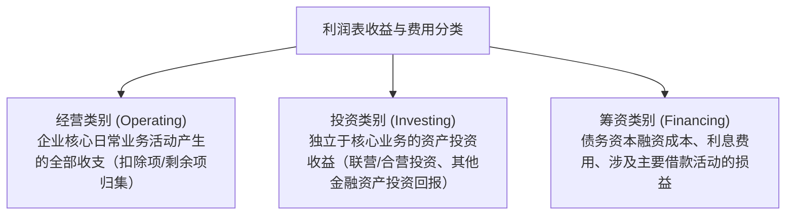

# 专题一：财务报表列报重大重塑——新 CAS 30 深度研析

> **法规文号**：财会〔2026〕11号《关于印发〈企业会计准则第30号——财务报表列报〉的通知》  
> **国际准则对标**：国际会计准则理事会（IASB）《国际财务报告准则第18号——财务报表中的列报和披露》（IFRS 18 Presentation and Disclosure in Financial Statements）  
> **生效时间**：自 2027 年 1 月 1 日起全面施行，鼓励企业提前执行。

---

## 一、 第一性原理：报表列报为什么迎来重构？

### 1.1 传统利润表的实务痛点
在传统中国企业会计准则（以及原 IAS 1）框架下：
1. **营业利润界限模糊**：虽然设置了“营业利润”项目，但没有清晰定义“经营活动”（Operating Activities）的内涵，导致投资收益、公允价值变动、资产处置损益等混合在营业利润中，不同企业之间可比性较差。
2. **“非准则指标”（Non-GAAP Measures）野蛮生长**：许多上市公司在投资者交流会、管理层讨论与分析（MD&A）中广泛使用诸如 EBITDA、调整后营业利润（Adjusted Operating Profit）等指标，定义各异且缺乏可审计的附注调节，投资者难以判断其真实经营造血能力。
3. **“其他”杂项黑洞**：附注披露中过度汇总，大量费用被笼统塞入“其他费用”或“其他收益”，隐匿关键信息。

### 1.2 核心破局思路
新 CAS 30 对利润表进行底层范式重构：
- **按三大活动分类收益与费用**：将所有收支系统归入**经营（Operating）**、**投资（Investing）**、**筹资（Financing）**三大类别；
- **强制披露管理层业绩指标（MPMs）**：若在公开披露中宣称任何替代性业绩指标，必须在财务报表附注中编制调节表并纳入审计范围；
- **确立“重要性汇总与分解”刚性标准**：杜绝报表附注中的杂项黑洞。

---

## 二、 核心变革一：利润表三大分类与结构重塑

新列报准则下，利润表全面统一归类体系，定义了严格的类别互斥规则：



### 2.1 关键结构分层对照

| 利润表层级 | 现行准则结构 (旧 CAS 30) | 新准则结构 (新 CAS 30 / IFRS 18 对齐) | 核心差异及第一性原理 |
|-----------|------------------------|------------------------------------|-------------------|
| **第一小计** | 营业利润（混合了对外股权投资、金融工具公允价值波动） | **经营利润（Operating Profit）** | 剔除外部纯财务投资与纯筹资影响，真正反映主营资产与劳务创造的经营性现金流基础 |
| **第二小计** | 利润总额（扣除营业外收支） | **扣除筹资和所得税前利润（Operating Profit + Investing Results）** | 经营成果与独立对外投资成果之和，尚未扣减负债利息成本（对标息税前利润 EBIT） |
| **终极成果** | 净利润 | **净利润（Net Profit）** | 扣除所得税费用后的终极归属 |

> 📌 **核心判断规则（“剩余分类法”）**：
> 凡是不属于**投资类别**（如长期股权投资权益法核算收益、以公允价值计量且其变动计入当期损益的金融资产分红等）且不属于**筹资类别**（如银行借款利息支出、租赁负债未确认融资费用分摊）的收益或费用，**一律归入经营类别**。

---

## 三、 核心变革二：管理层业绩指标（MPMs）附注披露

### 3.1 什么是 MPMs（Management Performance Measures）？
管理层业绩指标是指企业在财务报表附注之外向公众沟通时使用的、用于反映企业财务业绩全貌或某一部分的**损益类合计或小计指标**（例如：Adjusted EBITDA、调整后净利润、扣除非经常性折旧后营业利润）。

### 3.2 附注披露四部曲（强制要求）
若企业使用了任何 MPM，必须在报表附注中提供以下四重披露：
1. **指标定义**：清晰陈述 MPM 的内涵、计算公式以及为什么管理层认为该指标能提供有用的决策信息。
2. **报表项目调节表（Reconciliation Table）**：编制将 MPM 与最直接可比的准则规定小计（如经营利润、净利润）逐项调节的明细表。
3. **所得税与非控制性权益影响**：逐项说明调节项目对所得税费用和少数股东损益的具体影响金额。
4. **前后一致性**：若当期变更了 MPM 的计算方法，必须说明原因并重述前期对比数据。

---

## 四、 核心变革三：信息汇总与分解原则（Aggregation & Disaggregation）

1. **避免过度汇总**：具有不同性质、功能或经济风险的单项项目不得合并列报。
2. **限制“其他”类项目规模**：如果某“其他费用”或“其他资产”项目金额超过其所属类别总额的一定比例（如 10%），必须在附注中进一步分解披露其实质构成，禁止将重要单项混杂在“其他”项目中。

---

## 五、 会计实务与分录联动：列报重构对会计处理的影响

> ⚠️ **特别提示**：列报准则的重构不改变资产与负债的初始及后续计量方法，但深刻改变了损益科目的报表列示映射表。

```
【典型报表映射关系更新】
1. 保证类产品质保预计负债变动（依据解释第18号）：
   旧映射：销售费用（期间费用）
   新映射：营业成本 ➔ 经营利润（直接计入经营类别成本）
2. 权益法核算的联营企业投资收益：
   旧映射：营业利润中的“投资收益”
   新映射：投资类别收益（不计入“经营利润”，计入“扣除筹资和所得税前利润”）
3. 债务工具借款利息费用：
   旧映射：财务费用
   新映射：筹资类别损益（在“扣除筹资和所得税前利润”下方单列扣除）
```

---

## 六、 跨科联动考点矩阵

> 🔗 **跨科联动：**
> - **会计 ↔ 财务成本管理**：新 CAS 30 的“经营利润”与“筹资类别”划分，使得准则财务报表与财管中“管理用资产负债表与管理用利润表”的划分边界实现了历史性高度贴合，计算核心 ROE（权益净利率分解模型）时的数据口径调整难度显著降低。
> - **会计 ↔ 审计**：MPMs 正式进入财务报表附注，意味着注册会计师必须对其**执行审计程序**（验证调节项目的计算准确性、披露理由的合理性与跨期一致性），改变了过去审计师只对正文负责、对管理层外部口径仅做“其他信息”阅读的惯例。
