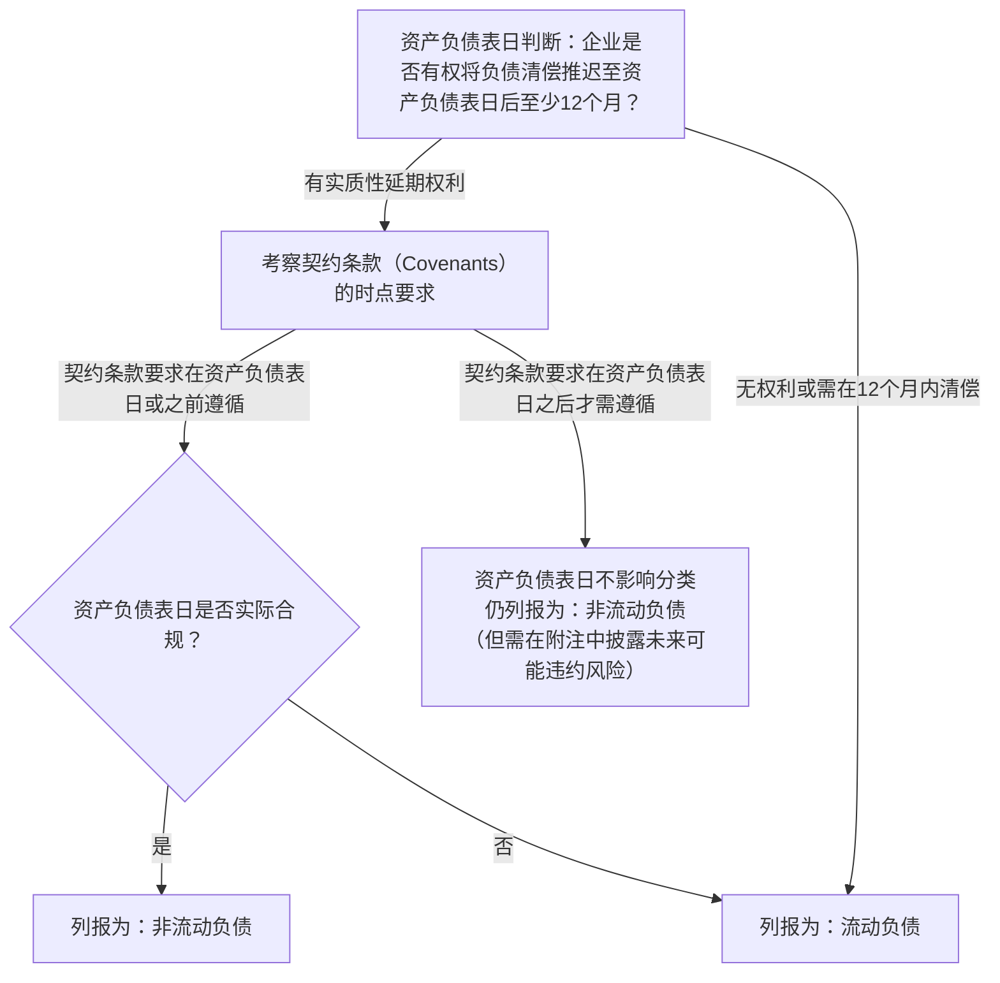

# 专题二：准则解释深度解析——第17号与第18号实务指南

> **法规文号**：  
> - 财政部《企业会计准则解释第17号》（财会〔2023〕21号，2024年1月1日起施行）  
> - 财政部《企业会计准则解释第18号》（财会〔2024〕24号，2024年12月6日发布并施行）  
>
> 这两项准则解释针对我国资本市场和企业实务中争议最大、最易出现操纵手法的痛点问题给出了明确规范。

---

## 一、 《企业会计准则解释第18号》：保证类质保金重大修正

### 1.1 第一性原理与修订背景
在向客户销售商品时，企业提供的质量保证分为两类：
- **服务类质量保证（Service-type Warranty）**：在基础达标承诺之外，为客户提供了单独的保修增值服务（构成**单项履约义务**，收入准则分摊对价并递延确认收入）。
- **保证类质量保证（Assurance-type Warranty）**：企业向客户承诺所销售商品符合既定标准与规格（**不构成单项履约义务**，遵循《或有事项》准则计提预计负债）。

**旧做法的问题**：过去绝大多数企业计提保证类质量保证时借记“**销售费用**”。然而从经济实质看：
1. 保证产品合格是生产交付的应有之义，产品缺陷产生的返修或更换支出，在实质上是**产品生产与制造过程的瑕疵成本**，而非销售撮合、广告推广产生的销售费用。
2. 计入销售费用虚增了“毛利率”，掩盖了制造业质量管控能力不足的生产短板。

### 1.2 现行法定账务处理（《解释第18号》标准分录）

```
1. 确认销售收入并计提保证类质量保证预计负债时：
   借：主营业务成本 / 其他业务成本 （★注意：严禁再借记销售费用！）
       贷：预计负债——产品质量保证

2. 实际发生质保维修、配件更换时：
   借：预计负债——产品质量保证
       贷：银行存款 / 原材料 / 应付职工薪酬

3. 资产负债表日根据最新经验估计数进行复核调整（若需要冲减）：
   借：预计负债——产品质量保证
       贷：主营业务成本 / 其他业务成本
```

### 1.3 会计政策变更与追溯调整要求
企业首次执行《解释第18号》时，若原计入“销售费用”，应当按照《企业会计准则第28号——会计政策、会计估计变更和差错更正》进行**追溯调整**（Retrospective Restatement）：
- **利润表重述**：调增前期“营业成本”，等额调减前期“销售费用”；
- **综合影响**：因营业利润和净利润总额未变，对前期留存收益与递延所得税净额无直接调整，但在可比期间**毛利率指标**会发生结构性下调，需在报表附注中详尽披露原因及受影响的项目金额。

---

## 二、 《企业会计准则解释第18号》：投资性房地产后续计量新规

### 2.1 适用范围
专门规范在**浮动收费法（Variable Fee Approach, VFA）**下作为基础项目持有的投资性房地产后续计量。

### 2.2 核心处理规定
对于保险合同等业务中，企业为履行浮动收费法保险合同义务而作为基础项目持有的投资性房地产：
- 允许企业选择采用**公允价值模式**进行后续计量；
- 确保基础资产（投资性房地产）的公允价值变动与对应保险合同负债计量基础保持对齐，避免因资产负债端计量模式不匹配而产生人为会计错配（Accounting Mismatch）。

---

## 三、 《企业会计准则解释第17号》：负债流动性划分与供应链金融

### 3.1 核心一：附带契约条款的流动负债与非流动负债划分



> 💡 **重要考点记忆**：
> 评估企业是否具有延期权利时，仅考虑**资产负债表日及之前**企业必须遵守的契约条款；**资产负债表日之后**才需要遵守的条款（例如次年6月30日才考核的财务指标），不影响资产负债表日该负债作为非流动负债的分类！

### 3.2 核心二：供应商融资安排（供应链反向保理）的透明度披露
针对企业利用供应链金融（如核心企业通过银行开立数字凭证、商业承兑汇票等方式延期支付应付账款，将商业信用转为金融信用的行为）：
- **禁止粉饰经营性现金流**：如果负债性质已实质由商业信用转为金融借款，需在附注中专项披露：
  1. 供应商融资安排的条款与条件；
  2. 安排中包含的负债总额及对应已计入的资产负债表项目（如应付账款、应付票据、短期借款）；
  3. 附带类似安排与不附带类似安排的供应商付款账期差异。

### 3.3 核心三：售后租回交易中卖方兼承租人的后续计量
- 明确卖方兼承租人对售后租回形成的**使用权资产**和**租赁负债**进行后续计量时，应当确保**不确认与所保留使用权有关的利得或损失**。
- 即使未来租赁付款额属于取决于指数或比率之外的可变租赁付款额，承租人在计算租赁期初负债时亦需合理估计分摊，防止在租回期间不当冲销使用权资产。

---

## 四、 跨科与跨章联动图谱

> 🔗 **跨章联动：**
> - [CICPA-Accounting/12-或有事项](../CICPA-Accounting/12-或有事项/12-或有事项-basics.md) ↔ 预计负债核算标准分录（保证类产品质保从销售费用转为营业成本）
> - [CICPA-Accounting/08-负债](../CICPA-Accounting/08-负债/README.md) ↔ 解释17号流动负债与非流动负债期末划分、供应商融资安排附注披露
> - [CICPA-Accounting/14-租赁](../CICPA-Accounting/14-租赁/README.md) ↔ 解释17号售后租回交易卖方兼承租人后续计量
>
> 🔗 **跨科联动：**
> - **会计 ↔ 税法**：保证类质保金计提时计入“主营业务成本”，但企业所得税税前扣除仍坚持“实际发生原则”（即预提时不得税前扣除，产生可抵扣暂时性差异并确认递延所得税资产；实际发生保修时方可据实税前扣除）。
> - **会计 ↔ 审计**：流动与非流动负债划分直接影响流动比率、速动比率等流动性偿债指标，审计人员需重点复核负债合同契约条款在基准日的合规证明文件，防止企业通过附条件展期粉饰短期偿债能力。
