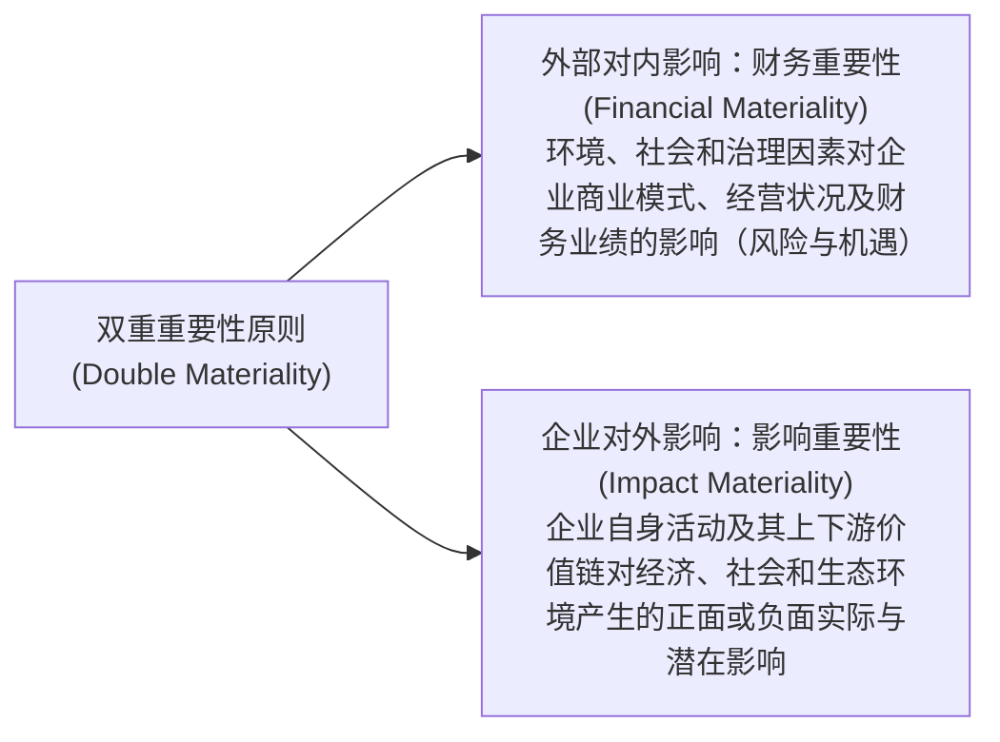

# 专题三：可持续披露准则与新会计法前沿

> **法规文号**：  
> - 财政部等九部门《关于印发〈企业可持续披露准则——基本准则（试行）〉的通知》（财会〔2024〕17号，2024年12月17日印发）  
> - 全国人大常委会《关于修改〈中华人民共和国会计法〉的决定》（2024年6月28日通过，2024年7月1日起施行）  
>
> 这两项法规代表了我国现代会计管理体制的“两大支柱”：顶层财会法律的强监管震慑体系，以及与国际接轨的 ESG 可持续信息披露国家标准体系。

---

## 一、 《企业可持续披露准则——基本准则（试行）》核心要点

### 1.1 准则定位与体系框架
中国国家统一的可持续披露准则体系由 **基本准则、具体准则和应用指南** 三个层次构成：
1. **基本准则**（统领地位）：规范基本概念、披露原则、目标、信息质量特征和通用披露框架；
2. **具体准则**：细化环境（E，如气候变化、生物多样性）、社会（S，如员工权益、社区关系）、治理（G，如商业道德、内部控制）的具体披露指标；
3. **应用指南**：提供实务操作指引与行业特定行业指南。

### 1.2 中国特色核心：“双重重要性”原则（Double Materiality）

国际上，国际可持续准则理事会（ISSB）偏向**财务重要性（单一重要性）**，而欧盟 CSRD 强调**双重重要性**。中国准则明确立足国情，采纳**双重重要性原则**：

### 1.3 可持续信息披露的“四支柱”核心要素
在进行可持续披露时，企业必须围绕以下四大核心支柱展开报告架构：
1. **治理（Governance）**：负责监督与管理可持续相关风险和机遇的组织架构、管理层职责及汇报机制；
2. **战略（Strategy）**：企业应对可持续风险和机遇的战略定位、对商业模式和资源分配的影响；
3. **风险和机遇管理（Risk & Opportunity Management）**：识别、评估、监控和管理可持续议题的常态化流程；
4. **指标和目标（Metrics & Targets）**：衡量企业可持续工作绩效的关键量化指标与设定的目标达成进度。

### 1.4 可持续信息与财务报表的钩稽互证
- **价值链连接**：披露不仅限于企业法人边界，须向上延伸至供应链、向下延伸至分销与客户价值链；
- **财务连带反应**：披露的可持续战略必须与财务报表中的数据相互印证。例如：若企业在可持续报告中承诺 2028 年提前关停淘汰高碳排放生产线，财务报表中对应固定资产必须相应**缩短折旧年限**或**计提资产减值准备**，杜绝“两张皮”虚假陈述。

---

## 二、 新修改《中华人民共和国会计法》深远影响

### 2.1 修改核心逻辑：从严惩治、强化财会监督
2024 年 7 月 1 日施行的新《会计法》是我国会计法治建设的里程碑，其核心修法方向为：
1. **大幅提高违法成本，告别“几十万顶格”时代**：
   - 过去财务造假单位处罚上限仅为 10 万元，直接责任人仅为 5 万元；
   - 新《会计法》将对伪造、变造会计凭证、会计账簿，编制虚假财务会计报告等违法行为的罚款上限：
     * **违法单位**：罚款上限大幅提高至**二百万元至一千万元**；
     * **直接负责的主管人员和其他直接责任人员**：罚款上限提高至**二十万元至二百万元**，情节特别严重的吊销会计从业资格，终身禁业。
2. **落实“单位负责人第一责任”**：
   - 明确企业法定代表人、实际控制人对会计工作的真实性、完整性负第一责任，杜绝将责任推诿给基层会计人员。
3. **现代财会监督法治化**：
   - 将内部控制制度建设、信息化与数字化会计档案安全、反洗钱与内部穿透审计全面纳入法定合规要求。

---

## 三、 跨科联动考点矩阵

> 🔗 **跨科联动：**
> - **会计 ↔ 战略**：可持续披露准则的“治理、战略、风险、目标”四支柱，与《公司战略与风险管理》中波特价值链模型、企业使命目标、ESG 战略转型及全面风险管理体系完全融合。
> - **会计 ↔ 经济法**：新《会计法》大幅提升的行政处罚额度，与《经济法》证券法律制度中虚假陈述民事赔偿责任（董监高连带赔偿）、中介机构看门人责任相互衔接。
> - **会计 ↔ 审计**：
>   1. 新《会计法》的高压态势显著放大了财务报表舞弊风险（管理层凌驾于内部控制之上的风险），促使注册会计师提高对异常关联交易、虚构业务的职业怀疑；
>   2. 随着可持续披露进入国家统一准则阶段，未来**可持续鉴证业务（ESG 鉴证）**将成为注册会计师业务的新增长极，CPA 考试大纲对此能力考查权重持续增加。
