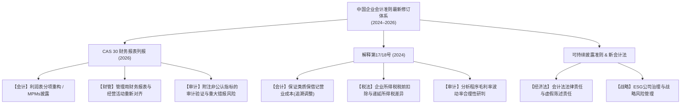

# 企业会计准则最新修订专题追踪（CAS Revisions 2024–2026）

> **本专题定位**：面向注册会计师（CICPA）全国统一考试专业阶段与综合阶段，系统研析中国财政部（MOF）2024 年至 2026 年间发布的**最新企业会计准则修订、准则解释、顶层财会法律法规及可持续披露准则**。
>
> 遵循项目核心的**第一性原理**教学法，穿透经济业务本质，提供标准分录模板、新旧列报对照、跨科联动分析及真题变式推演。

---

## 目录导航

| 专题模块 | 核心法规依据 | 涉及核心科目 | 学习重点 |
|---------|------------|------------|---------|
| [01-财务报表列报重大重塑(CAS30新规)](./01-财务报表列报重大重塑(CAS30新规).md) | 财会〔2026〕11号（对标 IFRS 18） | 会计、审计、财管 | 利润表三大活动重构、管理层业绩指标（MPMs）附注披露、汇总与分解 |
| [02-准则解释深度解析(第17号与第18号)](./02-准则解释深度解析(第17号与第18号).md) | 财会〔2024〕24号、财会〔2023〕21号 | 会计、审计、税法 | 保证类质保金调整为营业成本（追溯调整）、流动负债划分、售后租回 |
| [03-可持续披露准则与新会计法前沿](./03-可持续披露准则与新会计法前沿.md) | 财会〔2024〕17号、新《会计法》 | 会计、战略、经济法、审计 | ESG“双重重要性”披露、可持续信息与财报勾稽、严惩财务造假与审计责任 |
| [04-准则新规与CICPA考试联动与例题演练](./04-准则新规与CICPA考试联动与例题演练.md) | 2026 年 CICPA 考试大纲 | 六科全覆盖 | 综合题解题框架、易混陷阱、真题变式推演、Anki 闪卡记忆库 |

---

## 2024–2026 年中国准则演进全景时间线

```
2024.01 ── 解释第17号生效（流动负债契约条款判定、供应商融资安排披露）
2024.07 ── 新《中华人民共和国会计法》正式施行（强化财会监督、违法处罚上限升至百万元级）
2024.12 ── 解释第18号印发（财会〔2024〕24号：保证类质保金计入营业成本）
2024.12 ── 九部门发布《企业可持续披露准则——基本准则（试行）》（财会〔2024〕17号）
2025全年 ── 财政部密集印发实施问答（研发样机支出、收入总额法与净额法、数据资源入表实务）
2026.08 ── 新《企业会计准则第30号——财务报表列报》（财会〔2026〕11号）重磅发布，重塑利润表结构
```

---

## 准则变动对 CICPA 六科考查影响矩阵



> 🔗 **跨章联动：**
> - [CICPA-Accounting/01-总论](../CICPA-Accounting/01-总论/README.md) ↔ 会计法律法规体系与可持续信息披露大纲考点
> - [CICPA-Accounting/12-或有事项](../CICPA-Accounting/12-或有事项/README.md) ↔ 保证类质量保证账务处理与报表项目
> - [CICPA-Accounting/23-财务报告](../CICPA-Accounting/23-财务报告/README.md) ↔ 财务报表列报新格局与报表附注披露规范
